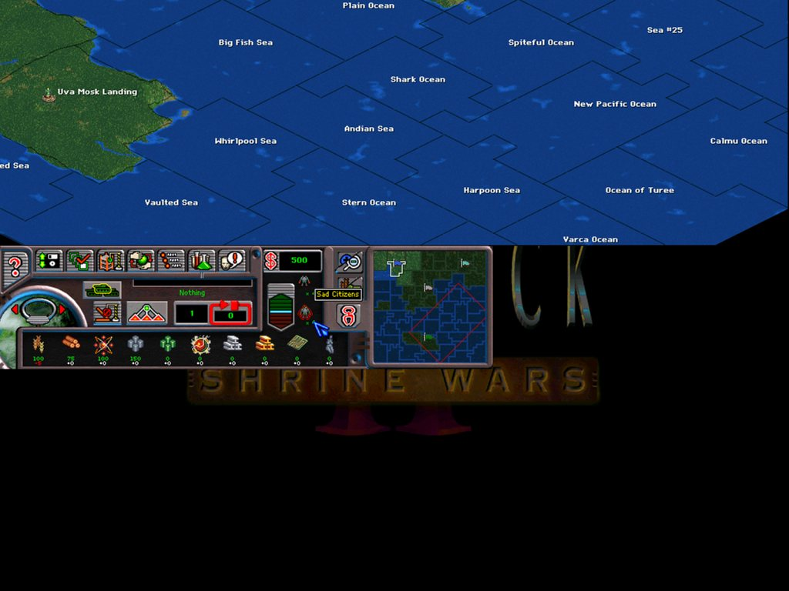

# Deadlock II: Shrine Wars — could the game run at 1024×768? Investigation notes

Date: 2026-10-18
Game: Deadlock II: Shrine Wars v1.20, GOG build (`DEADLOCK.EXE`, image base 0x400000, Borland C++), through GOG's `ddraw.dll` wrapper.
Status: read-only investigation. Nothing was changed. All addresses are virtual addresses; file offset = VA − 0x400800 for code.

---

## 1. Short answer

The game renders a fixed **640×480, 256-colour** frame. That size is not a setting; it is a literal constant
baked into the executable at roughly a hundred places, and the whole main screen (map viewport, frame art,
bottom panel, dialogs) is laid out for it. What the GOG wrapper already does, stretching the 640×480 frame
to the desktop with aspect correction, is the only cheap way to "run at 1024×768". A real 1024×768 mode,
with more visible map, is possible but is a proper modding project rather than a byte patch: a few
hundred code changes plus redrawn or re-tiled frame art, in a game with no source code.

## 2. What the display pipeline looks like

| VA | Role | Resolution dependence |
|----|------|-----------------------|
| `0x0046FAE4` | command-line parser (`-p`, `-w`, `-16`, `-8`, `-debug`, `-dd`, `-ns`, `-ms`, `-nosound`) | `-w` sets `[0x4D5A80] = 0` (windowed), `-16`/`-8` set `[0x4D5A8C]` (bits per pixel, default 8) |
| `0x0046FCA4` | game screen setup, called once from `0x004708D5` | calls the display init with literal `640, 480`; allocates the 640×480 back buffer `[0x4D5C28]` via `0x48C28D(640,480,0)`; creates the window via `0x4A5E40(0,0,640,480)` |
| `0x0048B623` | DirectDraw init | `SetCooperativeLevel` (`DDSCL_EXCLUSIVE|FULLSCREEN` = 0x11, or `DDSCL_NORMAL` = 8 when windowed), `IDirectDraw::SetDisplayMode(w, h, bpp)` at `0x0048B69D` (skipped when windowed), primary + back surface, and two "screen" objects at `0x65E644` / `0x65E6F4` whose width/height fields are filled from the arguments |
| `0x004814D6` | main map screen | map viewport 600×400 at (22, 24): `[0x4C5460] = 600`, `[0x4C5464] = 400`, `[0x4C5458] = 22`, `[0x4C545C] = 24`; the 600×400 map bitmap is allocated right above it |
| `0x0041C9A8`, `0x004204A0`, `0x00441055`, `0x0045AC13` | other screens | write the same view-rect array (`0x4C5450` + 32·n) from UI resource rectangles or computed centring |
| `0x00414EA4` | "redraw this region" | 48 call sites pass a literal `{0,0,640,480}` rectangle |
| `0x0049A9E7` | set clip rectangle | several callers pass literal `{0,0,640,480}` |
| `0x0041860C` and others in `0x0041xxxx` | hex grid → pixel conversion | result clamped with `cmp ecx,0x280` / `cmp edx,0x1E0` |

The engine's blitter (`0x48C85E` and friends) is generic: it reads width, height and bits-per-pixel from the
bitmap objects and already handles 8- and 16-bit surfaces. The resolution dependence is entirely in the
callers, not in the drawing code.

### Counting the hard-coded sites

A linear-sweep disassembly of the CODE section (`debug\full.asm`) finds:

| Pattern | Count | Meaning |
|---------|-------|---------|
| `push 0x280` / `push 0x1E0` pairs | 6 | display mode, back buffers, clear-screen fills |
| `mov [esp+8],0x280; mov [esp+0Ch],0x1E0` and `mov [ebp-8],0x280; mov [ebp-4],0x1E0` | ~36 pairs | full-screen `RECT`s for redraw/clip calls |
| `cmp reg,0x280` / `cmp reg,0x1E0` | several | coordinate clamps in map code |
| map viewport constants `0x258`/`0x190`/`0x16`/`0x18` | 1 site, 4 globals | 600×400 at (22,24) |

That is only the literal constants. Every panel, button and frame sprite of the main screen is placed by
coordinates that come from the UI resources (sprite frames in `SPRITENW.DAT` and rectangles the layout code
reads through `0x49EB44`), and the art itself is cut for a 640×480 frame: the map window is 600×400 with an
18-pixel right border and a 56-pixel bottom bar.

## 3. What is NOT in the way

- **Colour depth is not a blocker.** `-16` switches the surfaces to 16 bpp and the blitter supports it, so a
  high-resolution mode would not have to stay palettised.
- **Windowed mode exists.** `DEADLOCK.EXE -w` uses `DDSCL_NORMAL`, skips `SetDisplayMode` and runs in a
  640×480 window. Useful for testing a modified layout without exclusive mode.
- **The map viewport is parameterised at runtime.** Its size and position live in globals that the drawing,
  scrolling and hit-testing code read (about 20 readers each), so enlarging it is a matter of changing what
  gets written there and the size of the backing bitmap, not of rewriting the map renderer.

## 4. The three ways to get "1024×768"

### A. Scaled output (already available, zero risk)

The GOG wrapper (`dxcfg.ini`: `display=desktop`, `scaling=fit`, `aspect=enabled`) presents the 640×480 frame
at the desktop resolution with 4:3 bars. Choosing `display=1024x768`-style fixed modes in `dxcfg.exe` only
changes what the monitor is asked for; the game still draws 640 pixels across. Nothing more is gained here,
and the pixels are 1.6× magnified.

### B. Large-viewport mod (realistic, large)

Keep the UI at its 640×480 proportions but make the display and the map window bigger. Steps, in the order
they would be done and tested (`-w` windowed mode makes each step observable):

1. **Display and buffers.** Change the `640, 480` in `0x0046FCA4` (display init args, window size, back
   buffer) and the second back buffer at `0x00481208` to the new size. After this the game runs in a
   1024×768 mode with the 640×480 picture in the top-left corner.
2. **Full-screen rectangles.** Replace the ~36 literal `{0,0,640,480}` rects and the clip rect at
   `0x004151A5` with the new size, or better, redirect them to read the screen object's width/height
   (`[0x65E648]`, `[0x65E64C]`) so one place defines the size. Dialog centring that uses these rects then
   moves to the middle of the new screen automatically.
3. **Map viewport.** Change the four constants at `0x004814D6..0x004814F4` and the 600×400 bitmap
   allocation to 984×688 (keeping the 22/24 origin and the 18/56 borders), and check the other view-rect
   writers for screens that should stay centred instead.
4. **Main-screen frame and bottom bar.** The bar and frame are sprites positioned by resource rectangles.
   Either stretch/re-tile the art and rewrite the rectangles in the resource data, or hook the sprite
   placement to add (384, 288) offsets for everything anchored to the right or bottom edge. This is the
   part that cannot be done by patching constants and needs new or re-cut art.
5. **Coordinate clamps and hit tests.** Fix the `cmp ..,0x280/0x1E0` clamps in the map code and any
   mouse-to-hex conversions that assume the 600×400 window.
6. **Cursor save-under and dialogs.** These read the screen object's dimensions and should follow for free;
   verify with minimise/restore (see `Minimize-Crash-Investigation.md`).

Effort: a few hundred patch sites, most mechanical, plus art work, plus regression testing of every screen
(menu, map, planet view, diplomacy, tech, trade, editor, cinematics). Realistically weeks of part-time work
and a patcher that applies a table of changes rather than three bytes. The payoff is a 984×688 map window
instead of 600×400: 2.8× the visible area.

### C. Full 1024×768 UI (not realistic without source)

Re-laying out every dialog and panel for 1024×768, as the developers would have done, would mean rewriting
the resource rectangles for hundreds of widgets and redrawing all frame art. Not worth it compared with B.

## 5. The experiment, done (2026-10-18): `launcher\`

`launcher\launch.cmd` compiles `launcher\Launcher.cs` with the Windows-bundled C# compiler and starts
the game suspended, rewrites every width/height immediate listed in §2 (81 sites: 8 display/window/
buffer values, 4 map-viewport values, 2 cursor-clip values, 7 clamps, 60 whole-screen rectangles)
in the process memory from `launcher\deadlock2.cfg`, and resumes it. `DEADLOCK.EXE` is not modified.
`launch.cmd /dry` prints the table.

Result at `resolution=1024x768`, `windowed=0`, `bpp=16`, GOG wrapper with `display=desktop`:

- The game starts, plays the intro, shows the menu, the race selection, the landing-site map and the
  main screen, and reacts to the mouse everywhere. No crash, no hang. `DEBUG.TXT` looks normal.
- `SetDisplayMode(1024,768,16)` is accepted; the wrapper presents the 1024×768 surface in a 4:3 area
  of the desktop as it does for 640×480.
- Menus and dialogs are drawn at their 640×480 size in the top-left corner of the surface. The rest of
  the surface keeps whatever was there before (intro frames), because nothing clears it.
- **The map renders across the full 1024-pixel width**, with territory borders, names and units, and
  the minimap's view indicator grows accordingly. The viewport globals do drive the renderer.
- The HUD (buttons, resources, minimap) stays at its 640×480 position: y 320–480, x 0–640. Tooltips
  and buttons respond, so hit-testing of the HUD is intact. The strip to its right (x 640–1024) and
  everything below y 480 are never painted.

In `windowed=1` mode the GOG wrapper creates a desktop-sized borderless window and stretches only the
640×480 part of the drawing into it, so the enlarged surface is not visible there; use `windowed=0`.

What this proves: the renderer, the DirectDraw layer, the dialog system and the mouse all cope with a
bigger surface. What is left is exactly the layout work of §4 B steps 4–5: move the HUD to the bottom
edge, extend or re-tile its background and the frame art, and clear the newly exposed areas.

## 6. Suggested next step (superseded by §5)

If the goal is to see whether B is worth pursuing, the smallest informative test is steps 1–3 only:

- patch the display/buffer sizes and the viewport constants,
- run with `DEADLOCK.EXE -w -16` in a window,
- expect: a 1024×768 window, a 984×688 map area that scrolls and renders, the old 640×480 frame art drawn
  in the top-left with the right and bottom edges unfinished, dialogs possibly still placed for 640×480.

That shows how the map renderer and the hit-testing cope before any art work is started. The addresses
above are enough to build that patch; the disassembly in `debug\full.asm` and the WinDbg recipe in
`AI-Hang-Investigation.md` §8 cover the rest.
